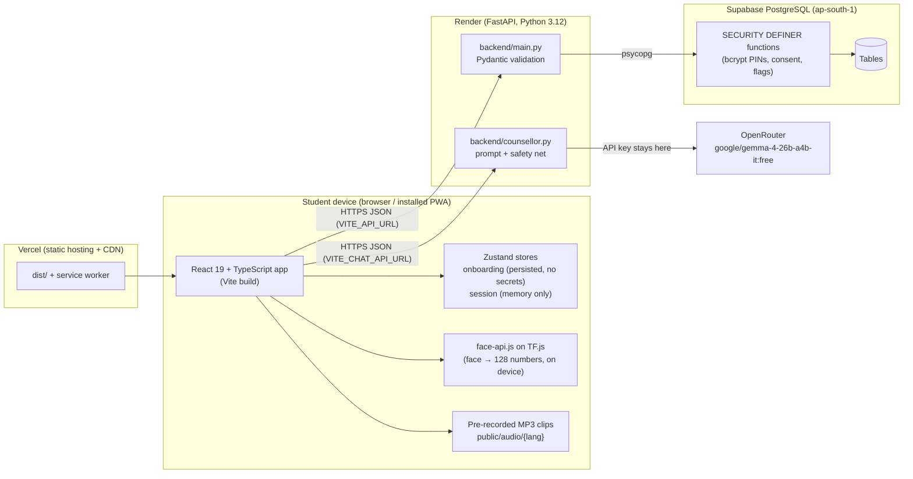
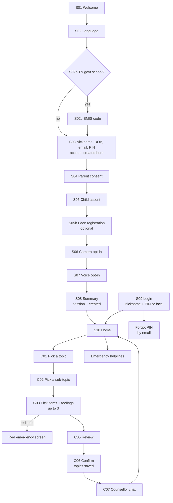

# ARAM

**Automated Resilience & Assessment Module.** A private, gentle wellbeing companion for
school students in India (roughly ages 10–18, many in hostels and government schools).
A student signs up with a nickname and PIN, tells ARAM what has been on their mind by
tapping through a guided set of topics, and then talks it through with an AI counsellor.
Anything that signals risk is flagged for staff and the student is shown real helplines.

It is a responsive PWA that runs on phones, tablets and laptops, in **English, Hindi,
Tamil, Telugu and Malayalam**, with pre-recorded voice for children who read slowly or
not at all.

> The full team documentation (every screen, endpoint, database function, the counsellor
> prompt, and the reasoning behind each design choice) is in
> [`docs/ARAM_Documentation.docx`](docs/ARAM_Documentation.docx).

---

## Contents

1. [What is built](#what-is-built)
2. [Architecture](#architecture)
3. [Tech stack by feature](#tech-stack-by-feature)
4. [Student journey](#student-journey)
5. [Getting started](#getting-started)
6. [Environment variables](#environment-variables)
7. [Backend API](#backend-api)
8. [Counsellor chat (LLM)](#counsellor-chat-llm)
9. [Database](#database)
10. [Face recognition](#face-recognition)
11. [Voice](#voice)
12. [Languages](#languages)
13. [Safeguarding](#safeguarding)
14. [Security and privacy](#security-and-privacy)
15. [Deployment](#deployment)
16. [Project structure](#project-structure)
17. [Known gaps before launch](#known-gaps-before-launch)

---

## What is built

| Area | Status |
|---|---|
| Onboarding (S01–S08): language, school type, EMIS, profile, parent consent, child assent, face, camera/voice opt-ins, summary | Built |
| Login (S09): nickname + PIN, face login, Forgot PIN by email, role picker for staff | Built |
| Home (S10), My details (profile, change PIN, opt-ins), clinician-alert re-offer (S11), Emergency helplines | Built |
| Topic selection (C01–C06): 8 topics → 33 sub-topics → 251 items, feelings, basket of up to 3, review and confirm | Built |
| Safeguarding flags: amber (staff review) and red (immediate-help screen) | Built |
| Counsellor chat (C07): AI counsellor talks the chosen topics through | Built, uses a free OpenRouter model for now |
| Staff (parent, headmaster, counsellor) face registration and sign-in, admin login, basic dashboard counts | Prototype |
| Assessment after the chat (body sensations, banding) | Not built |

## Architecture



Key principles:

- **The browser never talks to the database or to OpenRouter directly.** Everything goes
  through the FastAPI service, and all sensitive logic (PIN hashing, consent rules, face
  duplicate checks, safeguarding writes) runs inside PostgreSQL functions.
- **Mock mode.** With no `VITE_API_URL`, the app runs entirely in the browser using a
  local mock in `src/lib/api.ts`, so the UI can be reviewed with no backend at all.
- **Faces never leave as photos.** The camera frame is turned into a 128-number descriptor
  on the device; only that descriptor is sent.

## Tech stack by feature

| Feature | Technology |
|---|---|
| UI and screens | React 19, TypeScript 5.7, Vite 8 (Rolldown), plain CSS (`src/styles`) |
| Routing and consent guards | react-router-dom 7 (`RequireConsent`, `RequireAccount`, `RequireStaff` in `App.tsx`) |
| App state | Zustand 5. `onboardingStore` (persisted to localStorage, secrets excluded), `sessionStore` (memory only) |
| Translations | i18next + react-i18next, `src/i18n/{en,hi,ta,te,ml}.json` |
| Installable / offline | vite-plugin-pwa (Workbox). Voice clips are precached; face models cached on first use |
| Face registration and login | `@vladmandic/face-api` on TensorFlow.js (WebGL, CPU fallback), models in `public/models` |
| Voice out (ARAM speaks) | Pre-rendered MP3 clips made with AI4Bharat **Indic Parler-TTS** (`scripts/render_tts.py`, run on Colab) |
| Voice in (dictation) | Browser Web Speech API behind `src/speech/ISpeech.ts` (`MicButton`) |
| Backend API | Python 3.12, FastAPI 0.116, Pydantic 2, Uvicorn, psycopg 3 |
| Database | PostgreSQL 16 / Supabase, `pgcrypto` (bcrypt), migrations in `supabase/migrations` |
| Counsellor chat | OpenRouter chat completions API, model `google/gemma-4-26b-a4b-it:free` (configurable) |
| Hosting | Vercel (frontend), Render (API, Singapore), Supabase (database, Mumbai) |
| Lint / typecheck | oxlint, `tsc -b` |

## Student journey



## Getting started

Requirements: Node 22 (the npm scripts run it through `npx node@22`), Python 3.12 for the
backend, Docker for the local database.

```bash
npm install
npm run dev        # http://localhost:5173 (also on your LAN for phone testing)
npm run build      # typecheck + production build -> dist/
npm run preview    # serve the production build
npm run lint       # oxlint
```

**Mock mode (no backend).** Leave `VITE_API_URL` empty. Accounts, faces and logins are
kept in the browser's localStorage. To recover a forgotten test login, run
`JSON.parse(localStorage.getItem('aram.mock.child'))` in the browser console.

**Full local stack.**

```bash
sudo docker compose up -d --build     # PostgreSQL 16 + API on :8000
cp .env.example .env.local            # set VITE_API_URL=http://localhost:8000
npm run dev
```

Apply any migrations newer than your database volume with `supabase migration up` or `psql`.

**Counsellor chat only (rest of the app stays in mock mode).**

```bash
cd backend
python3 -m venv .venv && source .venv/bin/activate
pip install -r requirements.txt
echo "OPENROUTER_API_KEY=sk-or-..." > .env
uvicorn main:app --port 8000
```

Then set `VITE_CHAT_API_URL=http://localhost:8000` in the frontend `.env` and restart
`npm run dev`. The chat endpoint does not need the database.

## Environment variables

| Variable | Where | Purpose |
|---|---|---|
| `VITE_API_URL` | Frontend | Backend base URL. Empty = mock mode |
| `VITE_CHAT_API_URL` | Frontend | Backend for the chat only. Defaults to `VITE_API_URL` |
| `DATABASE_URL` | Backend | PostgreSQL connection string |
| `FRONTEND_ORIGIN` | Backend | Comma-separated CORS origins (e.g. the Vercel domain) |
| `FRONTEND_ORIGIN_REGEX` | Backend | Optional pattern for Vercel preview URLs |
| `OPENROUTER_API_KEY` | Backend only | OpenRouter key. Never put it in a `VITE_` variable |
| `OPENROUTER_MODEL` | Backend | Model id, default `google/gemma-4-26b-a4b-it:free` |

`VITE_` variables are baked into the browser bundle at build time, so they must never hold
secrets, and changing one needs a rebuild.

## Backend API

All endpoints are JSON. Errors use FastAPI's `{"detail": "..."}`. Source: `backend/main.py`.

| Method | Path | Purpose | DB function |
|---|---|---|---|
| GET | `/health` | Liveness check (Render health check) | `SELECT 1` |
| POST | `/api/students` | Create account (nickname, age band, PIN, email, language, EMIS). 409 `email_taken` | `create_child` |
| POST | `/api/students/{child_id}/finalize` | Save consents and opt-ins, create session 1 | `finalize_onboarding` |
| POST | `/api/students/{child_id}/verify-pin` | Check PIN for a known account (3 tries then lock) | `verify_pin` |
| POST | `/api/students/{child_id}/face` | Register face descriptor (duplicate check) | `register_face` |
| POST | `/api/students/{child_id}/verify-face` | Compare a face to this account | `verify_face` |
| POST | `/api/students/{child_id}/face-override` | Staff face authorises skipping the face step (unused in UI) | `authorise_face_skip` |
| POST | `/api/students/{child_id}/discard` | Delete an unfinished duplicate signup | `discard_unfinished_child` |
| GET | `/api/students/{child_id}/profile` | Profile incl. email, consents, face status | `get_child_profile` |
| POST | `/api/students/{child_id}/nickname` | Rename | `update_child_nickname` |
| POST | `/api/students/{child_id}/pin` | Change PIN (current PIN required) | `change_child_pin` |
| POST | `/api/students/{child_id}/optins` | Change camera / voice opt-ins | `update_child_optins` |
| GET | `/api/students/{child_id}/context` | Home screen stats + pending clinician alert | `get_returning_context` |
| POST | `/api/students/{child_id}/clear-alert` | Mark the S11 re-offer as shown | `clear_clinician_alert` |
| POST | `/api/students/login` | Find account by nickname + PIN | `login_child_by_pin` |
| POST | `/api/students/login-face` | Find account by face | `login_child_by_face` |
| POST | `/api/students/forgot-pin/lookup` | Find account by signup email | `lookup_child_by_email` |
| POST | `/api/students/forgot-pin/reset` | Set a new PIN by email, unlocks the account | `reset_child_pin_by_email` |
| POST | `/api/students/{child_id}/sessions` | Open a session when C01 starts | `start_session` |
| POST | `/api/sessions/{session_id}/safeguard-flag` | Write an amber/red flag immediately | `raise_safeguard_flag` |
| POST | `/api/sessions/{session_id}/cluster-flags` | Save the confirmed basket | `save_cluster_selection` |
| POST | `/api/chat` | One counsellor reply (stateless) | none, calls OpenRouter |
| POST | `/api/staff/register` | Register parent / headmaster / counsellor with a face | `create_staff_user` |
| POST | `/api/staff/verify-face` | Staff face sign-in | direct query on `app_user` |
| POST | `/api/admin/login` | Admin username + password | `verify_admin` |
| GET | `/api/users/{user_id}/dashboard` | Staff dashboard counts | `get_user_dashboard_summary` |

The full request and response shapes are in the team documentation.

## Counsellor chat (LLM)

After the student confirms their topics, `src/screens/CounsellorChat.tsx` opens a chat.
Each turn the app sends the topics (in English), the feelings, the student's language and
the conversation so far to `POST /api/chat`. `backend/counsellor.py` adds the system prompt
and calls OpenRouter. Nothing is stored; the transcript lives only on that screen.

- **Prompt:** `SYSTEM_PROMPT` in `backend/counsellor.py`. ARAM is a humble, polite school
  counsellor; replies in the student's language and script; 2–4 short sentences, one
  question at a time; understands the problem over several turns before suggesting one or
  two small steps and a trusted adult; never diagnoses, names medicines or asks for
  identifying details; on any risk it stops probing and gives Tele-MANAS **14416** and
  Childline **1098**.
- **Safety net:** a keyword check (`CRISIS_PATTERN`, all five languages and romanised
  Hindi) on the student's latest message makes the app pin a helpline card on screen.
- **Robustness:** if a provider rejects a system role, the prompt is folded into the first
  message and retried. 429/5xx become a friendly "busy, try again".
- **Output safety:** replies are HTML-escaped before display.

## Database

PostgreSQL with all business rules in `SECURITY DEFINER` functions; tables are not exposed
to anonymous clients. Migrations, applied in order:

| Migration | What it adds |
|---|---|
| `0001_init.sql` | `school`, `child`, `session`, `audit_log`; PIN hashing, consent, verify PIN |
| `0002_user_roles_and_student_details.sql` | `app_user`, roles, staff tables, student profile/consent/preference, face registration |
| `0003_pgcrypto_search_path.sql` | Fixes `pgcrypto` lookup on hosted Supabase |
| `0004_child_login.sql` | Login by nickname + PIN, and by face, for a new device |
| `0005_cluster_selection.sql` | `cluster_flag`, `safeguard_flag`, `start_session`, save basket |
| `0006_face_uniqueness.sql` | One face, one account; discard duplicate signups |
| `0007_face_scope_and_bands.sql` | Duplicate check scoped per school, block/review bands |
| `0008_child_profile_edits.sql` | Rename, change PIN, change opt-ins, profile read |
| `0009_child_email.sql` | Required, unique, lower-cased email at signup |
| `0010_forgot_pin.sql` | Look up and reset PIN by email (audited) |
| `0011_profile_email.sql` | Email in the profile response |

ER diagram: [`docs/ERD.md`](docs/ERD.md).

## Face recognition

`src/lib/faceApi.ts`. Tiny Face Detector, 68-point landmarks and the face recognition net
produce a 128-number descriptor. Matching is Euclidean distance: **< 0.6** is the same
person for login; for duplicate signups **< 0.45** blocks and **0.45–0.6** stores nothing
and flags for staff review. Detection tries a cheap pass, a fresh frame, then larger inputs,
a padded frame, and finally SSD MobileNet. Models warm up when the camera screen opens.
Face registration is optional; the PIN always works. Add `?facedebug=1` to the URL to log
detection timings and frame brightness.

## Voice

- **ARAM speaks** from pre-recorded MP3s in `public/audio/{en,hi,ta,te,ml}/<key>.mp3`.
  `src/speech/spokenKeys.ts` lists which lines each screen speaks; the session screens
  speak lines from the `sessionSpeech` i18n section chosen by what the child tapped.
  Option lists are not read aloud. A mute toggle is on every speaking screen.
- **Rendering clips:** `python3 scripts/render_tts.py --dry-run` shows every line;
  `--emit-colab` writes `scripts/aram_colab_render.py`, which runs on a free Colab T4 GPU
  and only renders missing clips. Clip names must match the i18n key exactly.
- **Never spoken:** nicknames, PINs and any string with `{{...}}`. Emergency and S11 are
  tap-to-play only. The live chat is not spoken.

## Languages

English, Hindi, Tamil, Telugu, Malayalam. All copy is in `src/i18n/*.json`. The topic
taxonomy, chat UI and spoken lines are translated in all five. The counsellor model is told
which language to reply in. Translations other than English are a first pass and need
native-speaker review, especially the safeguarding items.

## Safeguarding

- Every one of the 251 items has a hidden flag: ordinary, **amber** (79 items, session
  continues, staff review within 24–48h) or **red** (30 items, immediate-help screen, with
  one "I tapped this by mistake" undo).
- Flags are written the moment they are tapped, not when the basket is confirmed, and can
  never be retracted by the child.
- A pending clinician alert re-offers the helplines once at the next login (S11).
- Helplines: Tele-MANAS 14416, Childline 1098.

## Security and privacy

- No legal name, no date of birth (only an age band), no photos. PINs are bcrypt-hashed in
  the database. Three wrong PINs lock an account.
- Parent consent and child assent are both required before a session can exist.
- Session data (topics, chat) is never written to device storage.
- CSP, HSTS, `X-Frame-Options: DENY` and a strict Permissions-Policy (`vercel.json`).
- Camera and microphone are only requested after the child opts in.

## Deployment

| Part | Service | Notes |
|---|---|---|
| Frontend | Vercel | `npm run build`, output `dist`. Set `VITE_API_URL` (and/or `VITE_CHAT_API_URL`) |
| API | Render (`render.yaml`, free plan, Singapore) | Set `DATABASE_URL`, `FRONTEND_ORIGIN`, `OPENROUTER_API_KEY`. Free plan sleeps after ~15 min |
| Database | Supabase (Mumbai) | Apply new migrations with `supabase db push` before deploying code that needs them |

`backend/Dockerfile` is also available for container hosting.

## Project structure

```
src/
  screens/       one file per screen (S01…S11, C01…C07, Emergency, ForgotPin, MyProfile, staff)
  components/    Screen, SessionFrame, ChatStream, PinEntry, MicButton, VoiceControls, …
  data/          clusters.ts (topic taxonomy: ids, flags, cross-links)
  i18n/          en, hi, ta, te, ml JSON + setup
  lib/           api.ts (mock + backend), counsellorApi.ts, faceApi.ts, useCamera.ts, …
  speech/        spokenKeys.ts, audioTts.ts, useSpeak.ts (voice out); webSpeech.ts (voice in)
  state/         onboardingStore.ts, sessionStore.ts
  styles/        CSS
  flow.ts        route map and progress
  App.tsx        routes and guards
backend/
  main.py        FastAPI endpoints
  counsellor.py  chat prompt, safety net, OpenRouter call
public/
  audio/         voice clips per language
  models/        face-api model weights
scripts/         render_tts.py, aram_colab_render.py, cluster-audio-texts/
supabase/migrations/   schema and functions, applied in order
docs/            ERD.md, ARAM_Documentation.docx
```

## Known gaps before launch

- **Chat privacy:** free OpenRouter models may log or train on prompts and send data
  outside India. Switch to a private / zero-retention model before real students use it.
- **Chat crisis signals are not recorded** for staff yet; they only show helplines.
- **Email is not verified:** anyone who knows a student's email can reset their PIN.
- **Admin password** `admin` / `aram-admin` is in the frontend code and shown on screen.
- **Staff accounts** in mock mode are local demo data.
- **Native-speaker review** of all non-English text and audio.
- **English `s04.title` clip** is missing. The `new_audio/` folder duplicates committed clips.
- **DPDP:** verifiable parental consent, retention policy, breach process, hosting DPA.
- **Abuse hardening** of signup and PIN endpoints (rate limiting, EMIS allow-list).
- **Assessment** after the chat is not built yet.
